# 🧛 Grimório do Narrador — Portfólio Visual & Apresentação

Este diretório contém capturas de tela em alta definição do **Grimório do Narrador**, uma aplicação web gótica e responsiva desenvolvida para gerenciamento completo de crônicas de **Vampiro: A Máscara (5ª Edição - V5)**.

---

## 🛠️ Stack Tecnológica
- **Frontend Core:** React 18, TypeScript, Vite
- **Estilização & Design:** Tailwind CSS, Temas Góticos Personalizados, Efeitos Carmesim e Pulso de Sangue, Glassmorphism
- **Componentes & UI:** Radix UI, Lucide Icons, Embla Carousel, React Flow / XYFlow (Diagramas interativos de relações)
- **Gerenciamento de Estado:** TanStack React Query, Context API, LocalStorage isolado por crônica e usuário
- **Mecânicas da V5:** Regras oficiais de D10, Dados de Fome, Críticos Bagunçados, Falhas Bestiais, Ameaça de Quebra de Máscara

---

## 📸 Galeria de Telas & Funcionalidades

### Tela de Login e Boas-Vindas Gótica
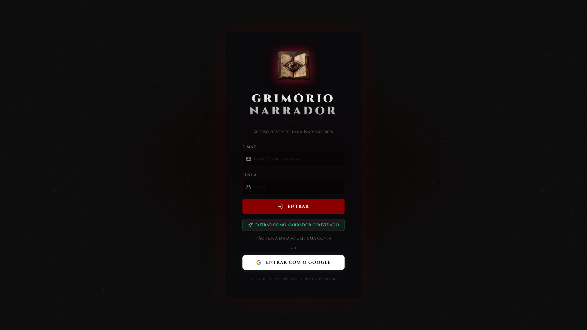

- **Arquivo:** `00-login.png`
- **Descrição:** Autenticação temática sombria com identidade visual de Vampiro a Máscara, efeitos atmosféricos e acesso rápido de Convidado.
- **Rota:** `/login`

---

### Painel Principal da Crônica (Dashboard)
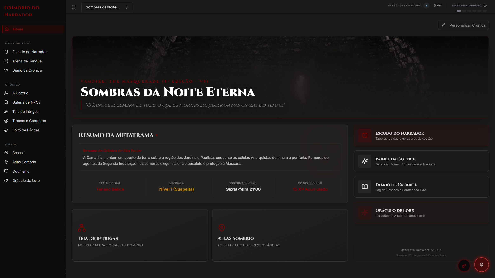

- **Arquivo:** `01-dashboard-cronica.png`
- **Descrição:** Visão geral da crônica, status de Máscara da cidade, atalhos rápidos e widgets temáticos de narrativa.
- **Rota:** `/`

---

### Membros da Coterie & Fichas

- **Arquivo:** `02-coterie-membros.png`
- **Descrição:** Gerenciamento dos membros do grupo vampírico, clãs, conceitos, atributos, disciplinas e ambições.
- **Rota:** `/coterie`

---

### Galeria de NPCs & SPCs
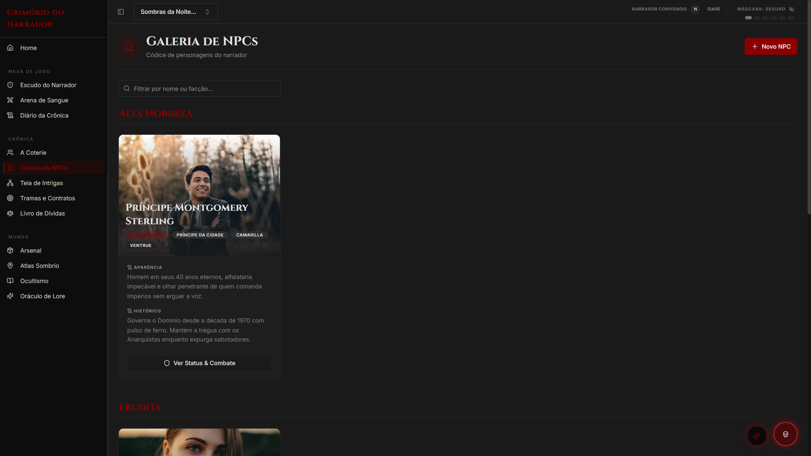

- **Arquivo:** `03-spc-npcs.png`
- **Descrição:** Fichas de personagens coadjuvantes, tipos de predador, contatos, rivais e seus níveis de ameaça.
- **Rota:** `/npcs`

---

### Teia de Relações (Graph View)
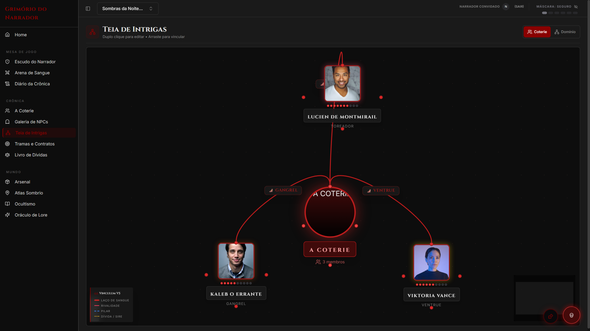

- **Arquivo:** `04-teia-relacoes.png`
- **Descrição:** Mapeamento visual e interativo de conexões, inimizades, laços de sangue e intrigas políticas da cidade.
- **Rota:** `/teia`

---

### Rastreador de Combate e Conflito V5
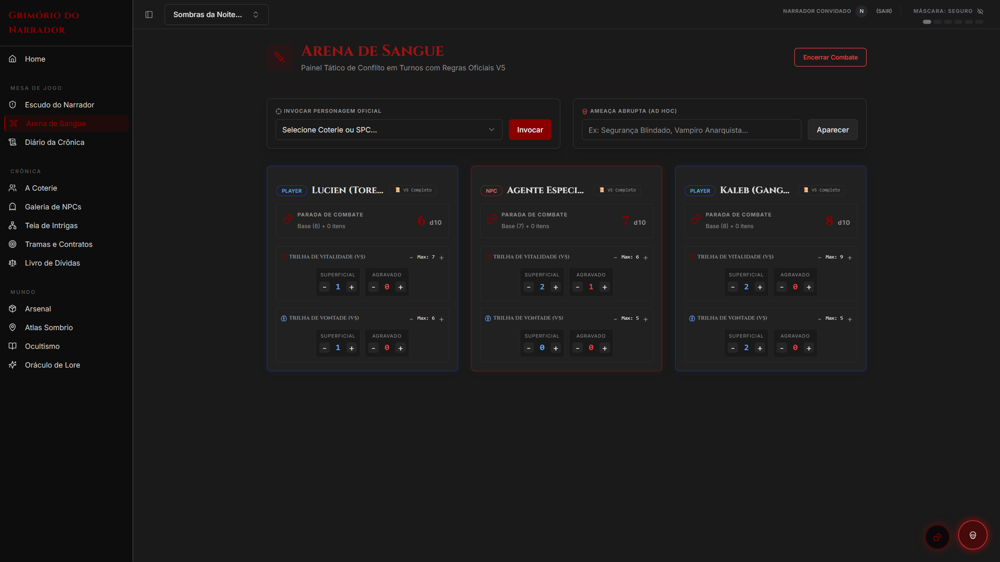

- **Arquivo:** `05-combate-iniciativa.png`
- **Descrição:** Controle de turnos, dano superficial e agravado, trilhas de vitalidade e força de vontade e testes de fome.
- **Rota:** `/combate`

---

### Escudo do Narrador (Quick Reference)
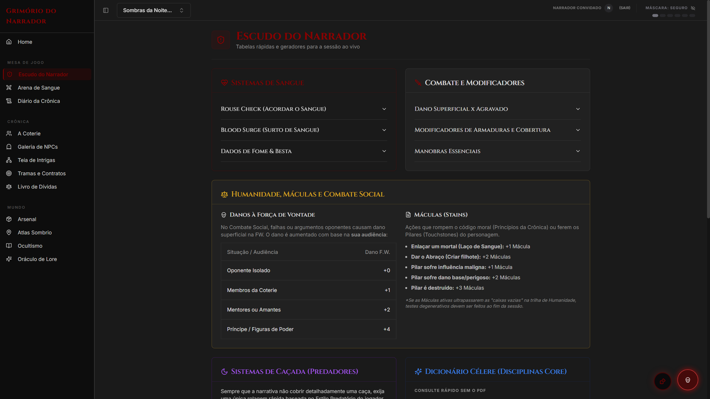

- **Arquivo:** `06-escudo-narrador.png`
- **Descrição:** Tabelas de regras rápidas da 5ª edição: dificuldades, regras de sangue, frenesi, compulsões e caçada.
- **Rota:** `/escudo`

---

### Oráculo do Narrador & Geradores Rápidos
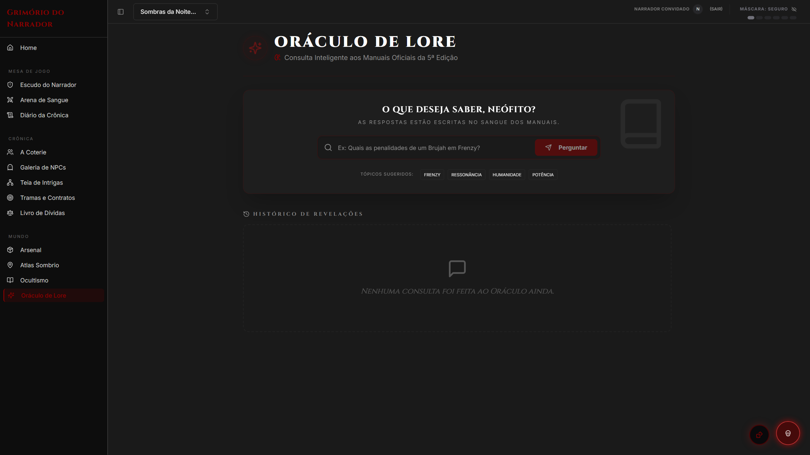

- **Arquivo:** `07-oraculo-geradores.png`
- **Descrição:** Sementes de tramas, ganchos narrativos, complicações de caçada e nomes temáticos de vampiros.
- **Rota:** `/oracle`

---

### Arsenal & Equipamentos
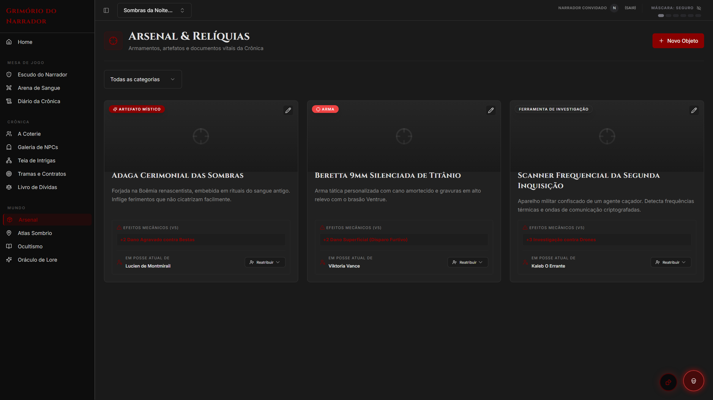

- **Arquivo:** `08-arsenal-equipamentos.png`
- **Descrição:** Armas de fogo, armas brancas, artefatos especiais e equipamentos táticos com regras de dano V5.
- **Rota:** `/arsenal`

---

### Atlas & Domínios Urbanos
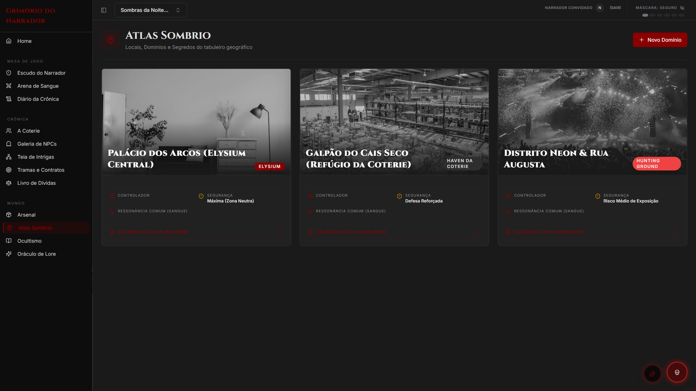

- **Arquivo:** `09-atlas-dominios.png`
- **Descrição:** Mapa e catálogo dos territórios, refúgios, locais de caça e influência das facções na cidade.
- **Rota:** `/atlas`

---

### Compêndio de Ocultismo & Disciplinas
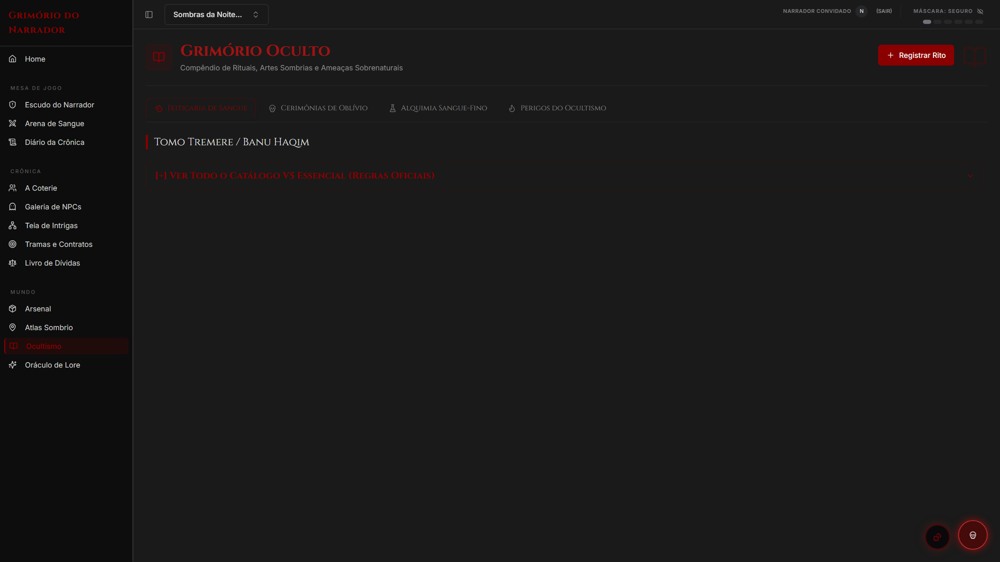

- **Arquivo:** `10-ocultismo-rituais.png`
- **Descrição:** Disciplinas vampíricas, poderes de Feitiçaria de Sangue, Rituais e Alquimia do Sangue Ralo.
- **Rota:** `/ocultismo`

---

### Missões & Intrigas
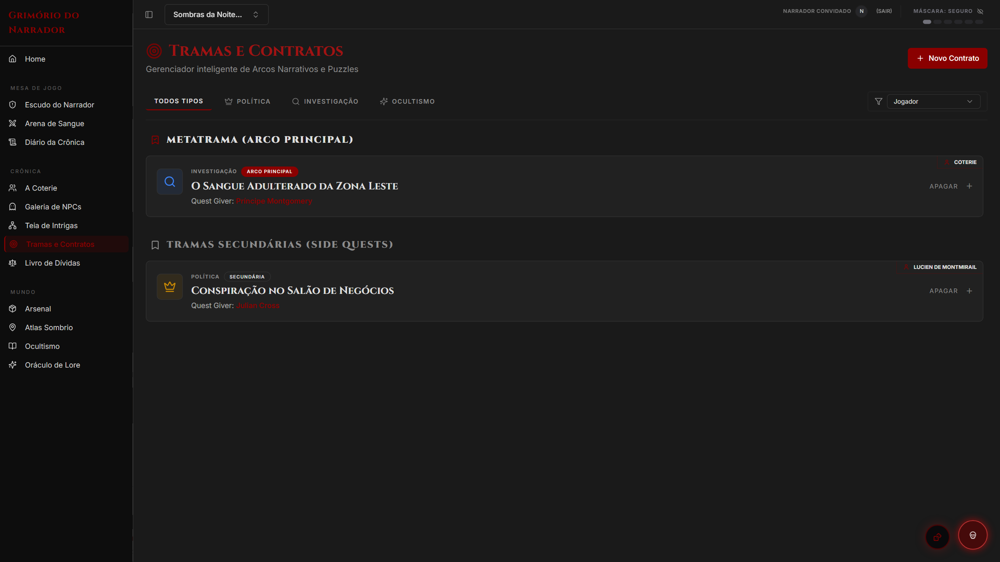

- **Arquivo:** `11-quests-intrigas.png`
- **Descrição:** Linhas de investigação ativas, conspirações da cidade e objetivos da Coterie.
- **Rota:** `/quests`

---

### Diário de Sessões da Crônica
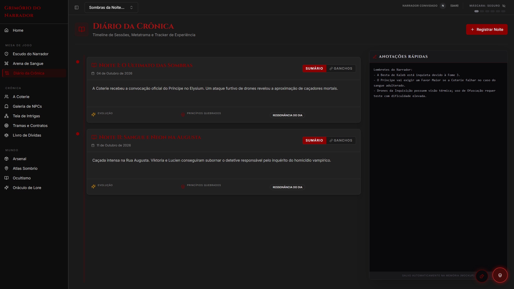

- **Arquivo:** `12-diario-cronica.png`
- **Descrição:** Registro cronológico dos eventos de cada sessão e resumos narrativos.
- **Rota:** `/diario`

---

### Livro de Favores (Boons)
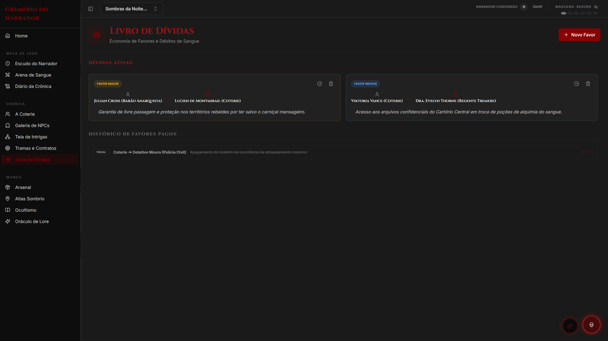

- **Arquivo:** `13-boons-favores.png`
- **Descrição:** Economia de favores da Camarilla: favores triviais, menores, maiores e de vida entre kindred.
- **Rota:** `/boons`

---

*Criado para apresentação em portfólio profissional (GitHub, LinkedIn, Behance).*
